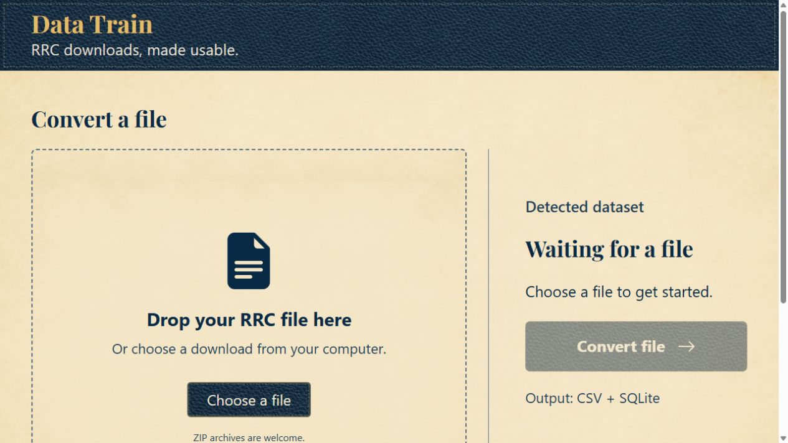

# Data Train

Turn supported Texas Railroad Commission downloads into CSV tables and a SQLite database, on your own computer.

## [⬇ Download Data Train for Windows](https://github.com/JJayT333/data-train/releases/latest/download/Data-Train-1.0.0-Windows-x64.zip)

[All releases](https://github.com/JJayT333/data-train/releases/latest)

The published download may not include changes in this source folder. In a Windows package, open **START HERE.html** for these instructions with a picture.

## Start on Windows

1. Download the Windows ZIP using the link above. Find it in your **Downloads** folder.
2. Right-click the ZIP, choose **Extract All**, and select **Extract**.
3. Open the extracted **Data Train** folder and double-click **Data Train.exe**. Your browser opens the app.

Keep the whole extracted folder together, including the `_internal` folder. Run the app from the extracted folder, not from inside the ZIP.

Python, Node and libraries are included. No developer tools, sign-in or runtime download is required. The Windows ZIP also includes the source in the **Source Code** folder. GitHub's separate Source code archives are for developers; use the Windows ZIP to run the app.

## Convert a file

1. Get a data file from the [Texas Railroad Commission download page](https://www.rrc.texas.gov/resource-center/research/data-sets-available-for-download/). You can leave the RRC file zipped.
2. In Data Train, drop the file in the box or click **Choose a file** and select it.
3. Check the detected dataset. If the app asks you to choose, select the name shown on the RRC download page.
4. Click **Convert file**. Large downloads can take a while and need free disk space.
5. When conversion is complete, click **Download results**. Find the results ZIP in your browser's Downloads and extract it to open the CSV files and SQLite database.

Use **Quit app** when finished. Closing the browser tab alone leaves the app running; double-click Data Train.exe to reopen it. Get downloads from the [official RRC data page](https://www.rrc.texas.gov/resource-center/research/data-sets-available-for-download/). Files stay on your computer and are not uploaded to an external service.

Data Train retains supplied RRC column headings. Headerless formats use existing RRC manual-derived field names in the bundled layouts. Identifier text, including leading zeros, is generally preserved; see the known limitation below. If you open a CSV in a spreadsheet, import identifier columns as text to keep those zeros. Related records can produce several tables; record totals can include child records.

Results remain under `%LOCALAPPDATA%\Texas RRC Data Converter\Results`. This internal storage name is retained for compatibility with earlier local builds; the app is Data Train. Logs are in the same parent folder. The downloaded results ZIP is a separate copy.

## Troubleshooting

| Symptom | What to do |
| --- | --- |
| Missing DLL/runtime or app will not start | Extract the complete ZIP again. Keep `_internal` beside Data Train.exe. Do not run inside the ZIP or copy only the executable. |
| Browser tab closed | Double-click Data Train.exe to reopen it. Quit an earlier converter build before starting Data Train. |
| File not identified | Choose its dataset manually. A filename extension alone cannot identify an RRC dataset. |
| Saved webpage detected | Download the actual data link from RRC, rather than using Save page as. |
| CSV reports nonempty extra fields | Check the original download and separator. The error names the file and line instead of silently dropping records. Empty trailing excess fields are accepted. |
| No records produced | Check the dataset choice and confirm the original download contains data. Zero-output runs are not success. |

The app uses localhost. If port 5055 is occupied, it chooses another available local port.

## Scope and limits

- Existing parsers cover supported ASCII, EBCDIC, dBase, CSV, JSON and compressed RRC downloads. Recognition combines known names with content/header/layout validation; ambiguous matches need your choice.
- Imaged products organize/index original files only, with **no OCR or text extraction**.
- Pending-permit parsing is marked **not yet verified**. Retired datasets are not offered.
- Oracle export dumps require Oracle import followed by text export before conversion.
- Shapefile/GIS conversion is outside this release.
- This is an **unsigned Windows x64 build**. Keep normal Windows security protections enabled. First-download reputation/signing behavior and a fresh Windows virtual machine have not been tested.
- Mac is deferred; no Mac release or compatibility claim is made. Large-file capacity and every field of every dataset have not been independently verified.
- Production Report for Pending Leases: a value beginning with a quotation mark may lose that mark. No such values were found in the tested download.

## Build from source on Windows

The repository/Source ZIP includes application and upstream source, layouts, manuals, instructions and notices. Large RRC example downloads, generated outputs and caches are omitted. Keep the sibling source directories together.

1. Install 64-bit Python 3.14 for development: `py -3.14 -m venv .venv`.
2. Install dependencies: `.venv\Scripts\python.exe -m pip install -r requirements-build.txt`.
3. Extract the official [Node v24.18.0 Windows x64 archive](https://nodejs.org/dist/v24.18.0/) and verify it against that directory's SHASUMS256.txt. Keep LICENSE with node.exe.
4. Run `.venv\Scripts\python.exe build_release.py --node-dir "PATH-TO-NODE-FOLDER" --output "PATH-TO-RELEASE-OUTPUT"`.
5. Test the generated Windows ZIP after extraction before distributing it.

The build uses PyInstaller folder mode and Waitress. It includes built W-1 JavaScript, Node, Python dependencies, layouts and upstream decoding helpers. Conversion never runs npm or installs packages.

For source execution, run `.venv\Scripts\python.exe rrc-drop-runner\launcher.py`. W-1 source execution also needs Node on PATH unless `runtime\node.exe` is beside the sibling source directories. Developers can set `RRC_DATA_DIR` to a writable data folder or `RRC_NO_BROWSER=1` to suppress browser opening in tests. These internal configuration names remain for compatibility.

## Notices

Read [LICENSE](LICENSE), [ATTRIBUTION.md](ATTRIBUTION.md), [THIRD-PARTY-NOTICES.txt](THIRD-PARTY-NOTICES.txt) and [W1-ISC-NOTICE.txt](W1-ISC-NOTICE.txt). The Windows package includes runtime/font/material notices under `Licenses` and exact dependency versions in `build-versions.json`. The application's MIT license does not replace bundled projects' licenses.

Data Train is independent of the Railroad Commission of Texas and is not an official RRC product.
